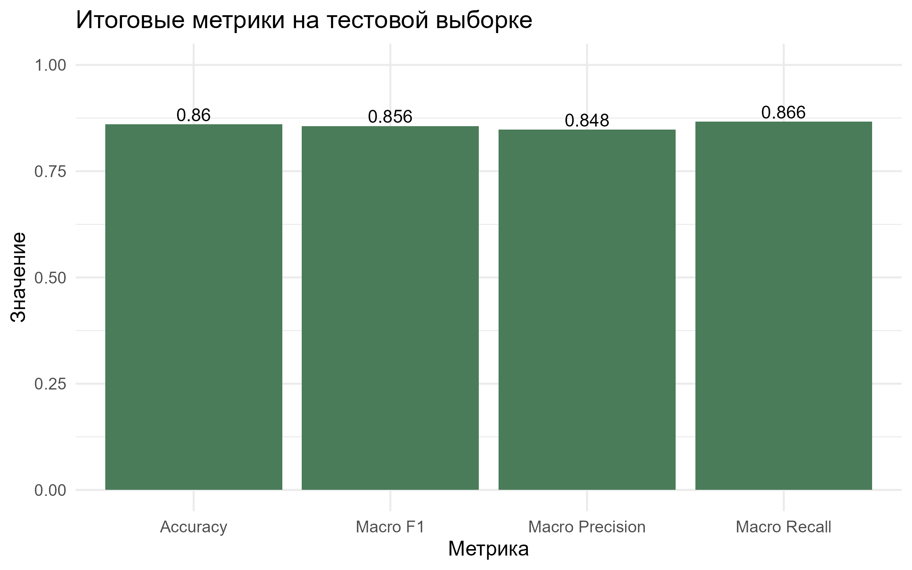
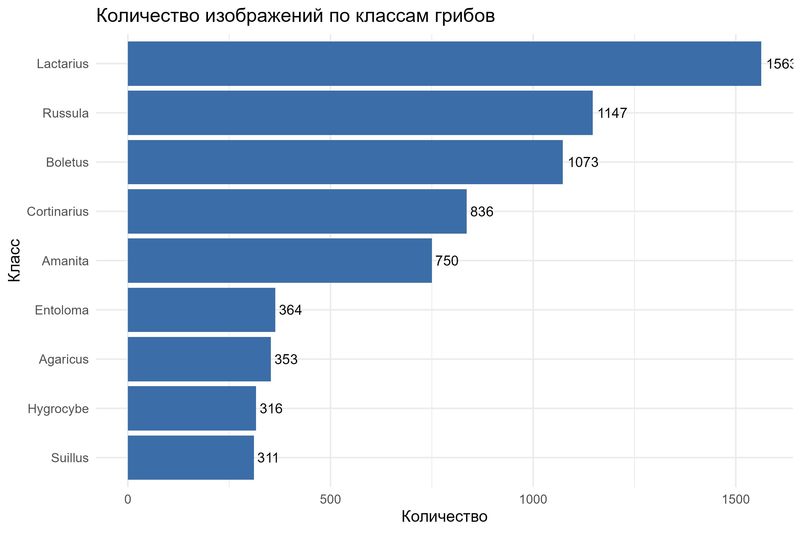
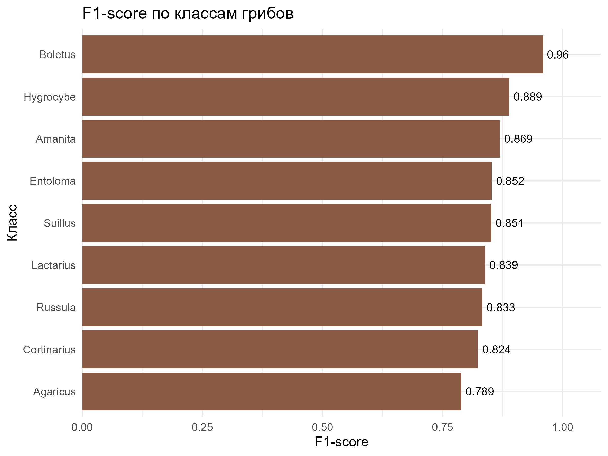
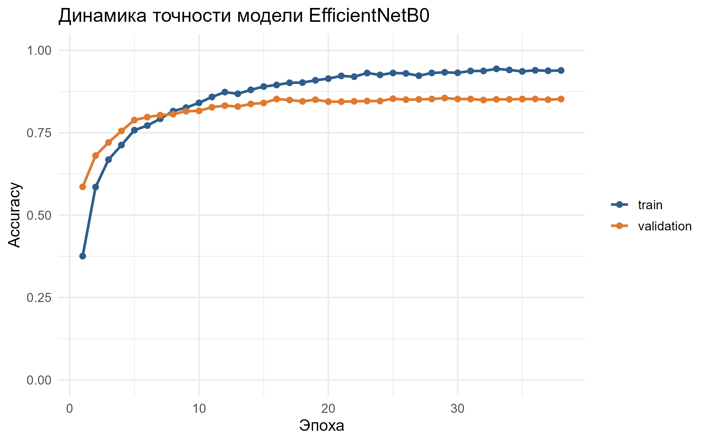
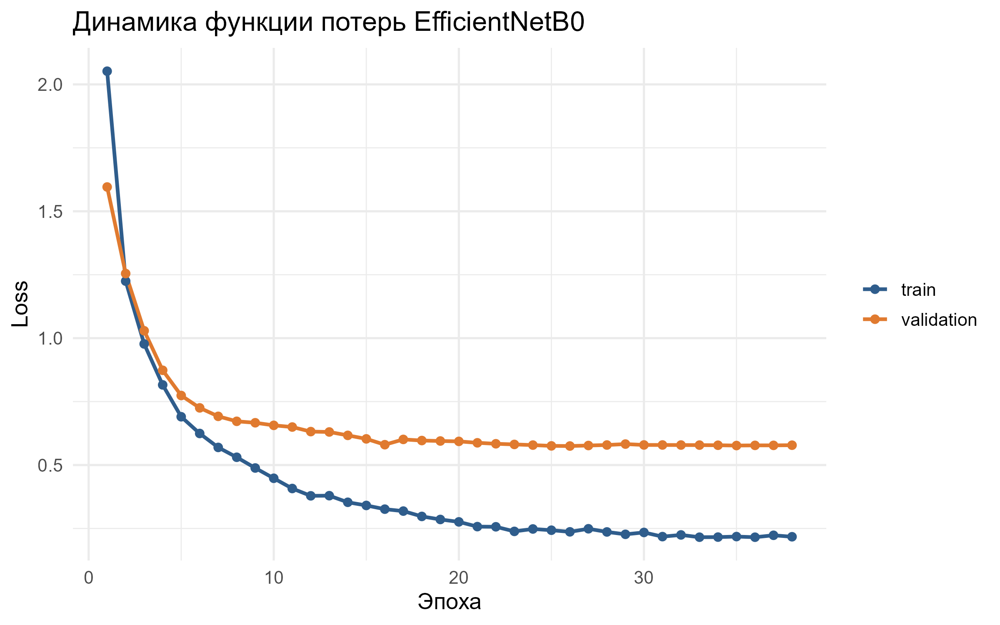
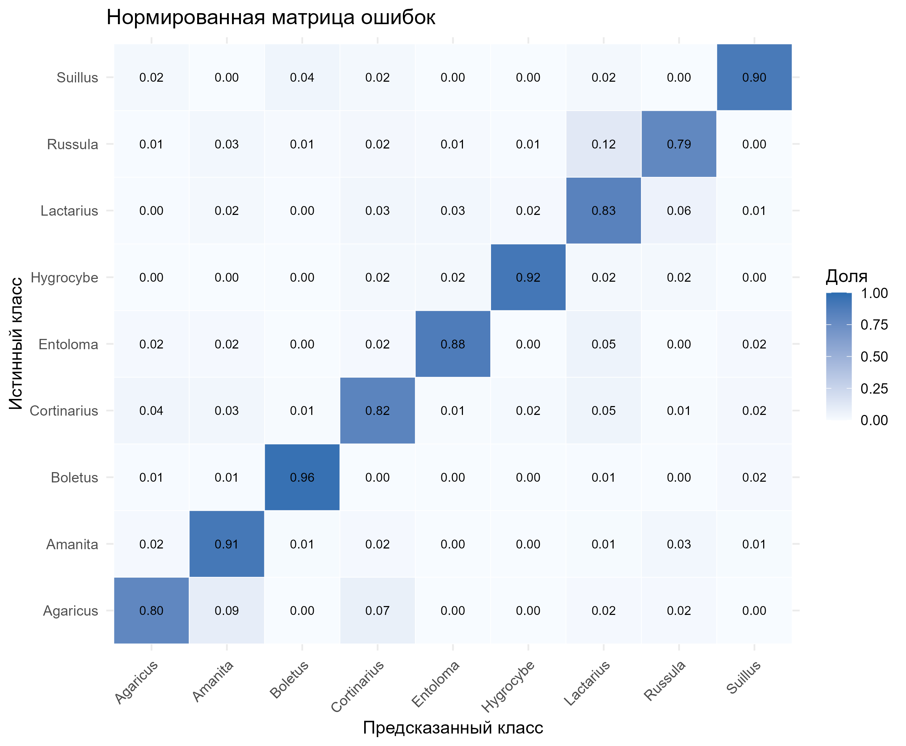
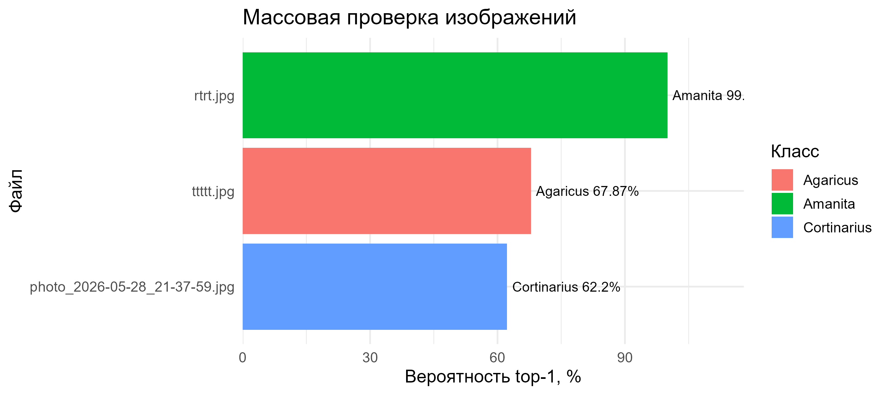

# Mushroom Vision

### Компьютерное зрение для распознавания грибов по фотографии

<p align="center">
  
  
  
  
</p>

<p align="center">
  <strong>Проект для распознавания грибов: от исходных данных до понятного результата на новой фотографии.</strong>
</p>

Mushroom Vision - это проект по автоматическому распознаванию родов грибов на изображениях. На вход модель получает обычную фотографию, а на выходе возвращает наиболее вероятный класс, вероятность предсказания и ближайшую альтернативу. За этой короткой формулой стоит полноценный путь машинного обучения: подготовка данных, честное разбиение выборки, transfer learning, серия экспериментов, отбор модели, ансамбль и анализ ошибок.

Проект задуман не как безликая учебная работа с одной итоговой цифрой, а как понятная и аккуратная витрина навыков в Computer Vision. Здесь можно посмотреть, как устроен датасет, почему выбрана именно EfficientNetB0, как модель ведет себя на разных классах и что происходит, когда ей показывают новое изображение.

> Важное уточнение: модель определяет только род гриба среди девяти классов датасета. Она не оценивает съедобность и не должна использоваться для принятия решений о сборе или употреблении грибов.

<p align="center">
  
</p>

## Идея проекта

Грибы - сложный объект для компьютерного зрения. На фото они могут быть сняты в тени, под дождем, с разных ракурсов, частично закрыты травой или листьями. У двух разных родов бывают похожие шляпки, ножки и цвета, а один и тот же род может выглядеть совсем по-разному на разных стадиях роста. Поэтому задача не сводится к поиску одного яркого признака: модели нужно научиться видеть сочетание формы, текстуры, цвета, контекста и общих визуальных паттернов.

Для этого использован transfer learning. Вместо обучения большой нейронной сети с нуля проект берет EfficientNetB0, уже обученную на ImageNet, как визуальный фундамент. Затем поверх полученных признаков обучается более компактная классификационная голова, адаптированная под конкретные классы грибов. Такой подход позволяет быстрее прийти к устойчивому результату и разумно использовать доступный объем данных.

Модель распознает следующие роды:

`Agaricus`, `Amanita`, `Boletus`, `Cortinarius`, `Entoloma`, `Hygrocybe`, `Lactarius`, `Russula`, `Suillus`.

## Основные результаты

Финальный запуск расположен в `mushroom_best_model_jupyter.ipynb`. В нем используется ансамбль нескольких классификационных голов EfficientNetB0, обученных с разными значениями `seed`. Такой вариант оказался сильнее одного отдельного запуска на независимой тестовой выборке.

| Метрика | Значение | Что показывает |
|---|---:|---|
| Accuracy | **86.01%** | Доля верных ответов среди всех тестовых изображений |
| Macro Precision | **84.79%** | Насколько редко модель ошибочно присваивает классы |
| Macro Recall | **86.64%** | Насколько хорошо модель находит изображения каждого класса |
| Macro F1 | **85.63%** | Сбалансированная итоговая оценка качества по всем классам |

Главная метрика проекта - Macro F1. Она особенно полезна, когда классы представлены неравномерно: крупный класс не может "перетянуть" оценку на себя и скрыть проблемы с более редкими грибами. В этом датасете разница между самым большим и самым маленьким классом заметная, поэтому одной только Accuracy было бы недостаточно.

Лучше всего модель распознает `Boletus` с F1-score `0.960`. Самым сложным в итоговом тесте оказался `Agaricus` с F1-score `0.789`, что дает понятную точку для следующего улучшения датасета и модели.

## Как это работает

```mermaid
flowchart LR
    image["Фотография гриба"] --> resize["Изменение размера: 224 x 224"]
    resize --> backbone["EfficientNetB0: извлечение признаков"]
    backbone --> heads["Несколько классификационных голов"]
    heads --> ensemble["Усреднение вероятностей ансамбля"]
    ensemble --> result["Top-1, Top-2, уверенность и предупреждение"]

    classDef input fill:#FDE68A,stroke:#B45309,color:#1F2937;
    classDef model fill:#BFDBFE,stroke:#2563EB,color:#1F2937;
    classDef result fill:#BBF7D0,stroke:#15803D,color:#1F2937;
    class image input;
    class resize,backbone,heads,ensemble model;
    class result result;
```



Каждое изображение приводится к размеру `224 x 224`. После этого EfficientNetB0 превращает картинку в набор признаков: в них уже закодированы детали, которые полезны для визуального различения объектов. На этих признаках работают пять обученных классификационных голов. Их ответы усредняются, а итоговый ансамбль возвращает не только лидирующий класс, но и степень уверенности.

Если уверенность ниже `65%` или разрыв между двумя лучшими вариантами меньше `15` процентных пунктов, предсказание помечается как неуверенное. Это честнее, чем всегда выдавать один класс без контекста: пользователь видит, когда модели лучше не доверять вслепую.

## Данные: чем обучалась модель

Датасет находится в папке `Mushrooms`. В нем **6 713 изображений**, разложенных по папкам-классам. Такая структура хорошо подходит для проверки данных глазами и делает проект понятным без отдельной базы данных или сложной разметки.

| Класс | Изображений | Доля датасета |
|---|---:|---:|
| Agaricus | 353 | 5.3% |
| Amanita | 750 | 11.2% |
| Boletus | 1073 | 16.0% |
| Cortinarius | 836 | 12.5% |
| Entoloma | 364 | 5.4% |
| Hygrocybe | 316 | 4.7% |
| Lactarius | 1563 | 23.3% |
| Russula | 1147 | 17.1% |
| Suillus | 311 | 4.6% |

Данные разделены стратифицированно: каждый класс попадает в обучающую, валидационную и тестовую выборки примерно в одинаковой пропорции. Благодаря этому тестовая оценка не оказывается случайно смещенной в сторону нескольких самых больших классов.

| Часть датасета | Изображений | Роль в эксперименте |
|---|---:|---|
| `train` | 4696 | обучение классификационных голов |
| `validation` | 1002 | выбор лучшего `seed` и контроль переобучения |
| `test` | 1015 | финальная независимая оценка |

Все результаты разбиения сохранены в `results_mushroom_cnn_r_efficientnet/dataset_split.csv` и `results_mushroom_cnn_r_efficientnet/split_counts_by_class.csv`.

## Как развивался проект

### 1. Подготовка и аудит датасета

Сначала был собран индекс изображений, проверено число файлов в каждом классе и сформирован список допустимых форматов. Затем проект автоматически построил таблицы с количеством изображений, списком классов и разбиением данных. Это избавляет от ручной подготовки и делает эксперимент воспроизводимым: при повторном запуске можно увидеть, какие файлы попали в каждую часть выборки.

### 2. Первый полноценный эксперимент

В `mushroom_best_model_reworked.ipynb` реализован end-to-end вариант с обучением EfficientNetB0 в два этапа: сначала обучается новая классификационная голова, затем часть базовой сети размораживается для донастройки. Этот notebook сохраняет историю обучения, метрики, матрицу ошибок и служит исследовательской площадкой проекта.

### 3. Финальная модель

В `mushroom_best_model_jupyter.ipynb` акцент смещен на стабильность результата и скорость повторных экспериментов. Признаки EfficientNetB0 сохраняются в `efficientnet_b0_features.npz`, поэтому тяжелая часть извлечения признаков не пересчитывается каждый раз. Поверх них обучаются несколько голов с разными `seed`, а затем сравниваются их результаты на валидационной выборке.

### 4. Ансамбль и контроль качества

Пять запусков с `seed` `11`, `42`, `73`, `123`, `2026` позволяют снизить зависимость результата от случайной инициализации. Лучший одиночный запуск получен при `seed = 42`, но итоговый ансамбль показал лучший Macro F1 на тестовой выборке. В проекте сохранены таблицы выбора модели, метрики по классам, история обучения и итоговая JSON-сводка эксперимента.

### 5. Проверка реальных изображений

Финальная часть проекта - инференс для новых фотографий. Достаточно положить изображения в `predict_images`, запустить соответствующую ячейку и получить таблицу с результатами. В ней есть топовый класс, вторая гипотеза, вероятность и флаг неуверенного предсказания.

## Технический стек

| Инструмент | Роль в проекте |
|---|---|
| R + Jupyter Notebook | Основной сценарий запуска и визуализация результатов |
| Python через `reticulate` | Связка R-ноутбука с ML-кодом |
| TensorFlow / Keras | Построение, обучение и сохранение моделей |
| EfficientNetB0 | Предобученный backbone для извлечения визуальных признаков |
| `dplyr`, `tidyr`, `readr`, `ggplot2` | Подготовка таблиц, анализ и графики |
| `numpy`, `pandas` | Работа с признаками, вероятностями и метриками |

Классификационные головы используют Batch Normalization, Dropout, Dense-слой на 512 нейронов и L2-регуляризацию. Во время обучения применяются class weights, `EarlyStopping`, `ReduceLROnPlateau` и `ModelCheckpoint`. Вместе эти элементы помогают учитывать дисбаланс классов, ограничивать переобучение и сохранять наиболее удачные веса.

## Результаты по классам

| Класс | Precision | Recall | F1-score |
|---|---:|---:|---:|
| Agaricus | 0.782 | 0.796 | 0.789 |
| Amanita | 0.831 | 0.912 | 0.869 |
| Boletus | 0.957 | 0.963 | 0.960 |
| Cortinarius | 0.831 | 0.817 | 0.824 |
| Entoloma | 0.831 | 0.875 | 0.852 |
| Hygrocybe | 0.863 | 0.917 | 0.889 |
| Lactarius | 0.848 | 0.830 | 0.839 |
| Russula | 0.878 | 0.792 | 0.833 |
| Suillus | 0.811 | 0.896 | 0.851 |

Подробные значения лежат в `results_mushroom_cnn_r_efficientnet/per_class_metrics.csv`. Такая таблица помогает смотреть дальше общей Accuracy: например, замечать классы, где модель уверенно находит изображения, но иногда путает их с похожими соседями.

## Визуальная часть

Репозиторий содержит не только числа, но и графики, по которым можно быстро понять ход эксперимента. На них видно распределение классов, динамику обучения, итоговые метрики, F1-score для каждого рода, нормированную матрицу ошибок и результаты массовой проверки пользовательских изображений.

<p align="center">
  
  
</p>

<p align="center">
  
  
</p>

<p align="center">
  
</p>

## Проверка своих фотографий

Для пользовательских изображений есть папка `predict_images`. В нее можно положить файлы форматов `.jpg`, `.jpeg`, `.png`, `.bmp` или `.webp`, а затем запустить последнюю часть финального notebook.

На выходе формируется файл `results_mushroom_cnn_r_efficientnet/batch_predictions.csv`:

| Поле | Что означает |
|---|---|
| `file` | имя проверяемого изображения |
| `top1` | самый вероятный класс |
| `top1_probability` | уверенность модели в процентах |
| `top2` | второй наиболее вероятный класс |
| `margin_pp` | отрыв top-1 от top-2 в процентных пунктах |
| `uncertain` | флаг, что предсказание стоит перепроверить |

Примеры текущего batch-запуска показывают, как меняется поведение модели: одно изображение было отнесено к `Amanita` с уверенностью `99.99%`, а другое получило флаг `uncertain`, потому что между двумя вероятными классами осталась небольшая дистанция. Это хороший пример того, почему полезно сохранять не только top-1, но и весь контекст решения модели.

<p align="center">
  
</p>

## Структура репозитория

```text
YAPSOD/
├── README.md
├── .gitignore
├── mushroom_best_model_jupyter.ipynb
├── mushroom_best_model_reworked.ipynb
├── Mushrooms/
│   ├── Agaricus/
│   ├── Amanita/
│   ├── Boletus/
│   ├── Cortinarius/
│   ├── Entoloma/
│   ├── Hygrocybe/
│   ├── Lactarius/
│   ├── Russula/
│   └── Suillus/
├── predict_images/
│   └── изображения для пользовательской проверки
├── results_mushroom_cnn_r_efficientnet/
│   ├── metrics_summary.csv
│   ├── per_class_metrics.csv
│   ├── confusion_matrix.csv
│   ├── model_selection.csv
│   ├── experiment_summary.json
│   ├── *.png
│   └── *.keras
└── results_mushroom_efficientnet/
    └── ранние результаты эксперимента
```

### Ключевые точки входа

| Файл или папка | Для чего нужна |
|---|---|
| `mushroom_best_model_jupyter.ipynb` | Финальный notebook: лучшая модель, ансамбль и инференс |
| `mushroom_best_model_reworked.ipynb` | Исследовательский end-to-end вариант обучения |
| `Mushrooms/` | Исходные изображения по классам |
| `predict_images/` | Новые фотографии для проверки |
| `results_mushroom_cnn_r_efficientnet/` | Метрики, графики, модели и экспортированные результаты |
| `results_mushroom_efficientnet/` | Ранний этап экспериментов |

## Как запустить проект

1. Установить R и Python `3.10+`.
2. Установить Python-зависимости:

```bash
pip install tensorflow keras pandas numpy pillow openpyxl
```

3. Открыть `mushroom_best_model_jupyter.ipynb` в Jupyter Notebook или JupyterLab.
4. В первой части notebook указать корректный путь к Python в переменной `RETICULATE_PYTHON`.
5. Запустить ячейки сверху вниз. Notebook сам проверит и при необходимости установит используемые R-пакеты.
6. Для инференса положить свои фотографии в `predict_images` и выполнить блок массовой проверки.

Если хочется сразу посмотреть альтернативный подход с дообучением части backbone, можно открыть `mushroom_best_model_reworked.ipynb`. Для знакомства с проектом и повторения финального результата лучше начинать с `mushroom_best_model_jupyter.ipynb`.

## Что можно улучшить дальше

- Вынести обучение и инференс из notebook в отдельные Python/R-скрипты.
- Добавить `requirements.txt` или `environment.yml` для одного запуска окружения.
- Сделать веб-интерфейс, в который можно перетащить фотографию гриба.
- Добавить Grad-CAM, чтобы визуально показывать, на какие области изображения опирается модель.
- Расширить набор классов с родов до отдельных видов.
- Собрать больше изображений для редких классов и целенаправленно улучшить `Agaricus`.
- Подключить Git LFS для тяжелых моделей и полного датасета.


